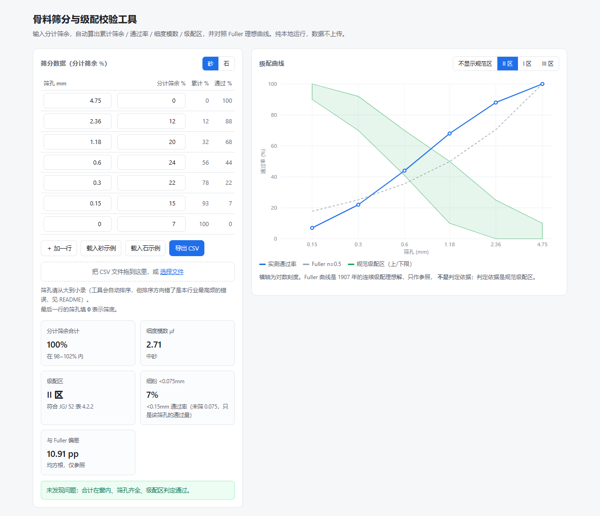

# aggregate-grading-toolkit

**骨料筛分与级配校验工具** —— 把「分计筛余」这一列数，算成可判定的级配结论。

零依赖 · 纯本地运行 · 离线可用 · 不含任何配合比求解算法。

[](https://jun4033323689.github.io/aggregate-grading-toolkit/)
[](https://github.com/jun4033323689/aggregate-grading-toolkit/actions/workflows/test.yml)
[](LICENSE)

**在线版（免安装）**：<https://jun4033323689.github.io/aggregate-grading-toolkit/>

> 输入 7 个筛孔的分计筛余，输出：累计筛余 → 通过率 → 细度模数 → 级配区判定 → 细粉含量 → 与 Fuller 曲线的偏差。



---

## 为什么做这个

筛分数据本身不难，难的是**口径**。同一张试验记录表，不同人算出来的细度模数能差 0.1，累计筛余方向搞反的直接差 100%。

这几个错误在试验室和搅拌站里天天发生，但没人专门做工具去拦：

| 典型后果 | 真实原因 |
|---|---|
| 细度模数算成 2.95，实际是 2.84 | 细度模数公式里 β1 的扣减项被漏掉 |
| 通过率曲线整体反了 | 累计筛余从最小筛孔往上加了 |
| 分计筛余合计只有 93%，没人发现 | 漏录筛底 |
| 石粉含量报成 7%，实际 0% | 把「0.15mm 通过率」当成了「<0.075mm 含量」 |
| 级配区判定「合格」，但曲线明显断级 | 只看单点，没看整条曲线的单调性 |

本工具把这些全部做成**自动拦截或显式告警**，而不是给出一个沉默的错数。

---

## 三种用法

### 1. 浏览器（推荐给试验室）

双击 `index.html` 即可，无需安装、无需联网。支持直接拖入 CSV，图上同时画实测曲线、规范级配区带、Fuller 参照线。

### 2. 命令行（批量校验）

```bash
node cli.mjs samples/                      # 校验目录下所有 csv
node cli.mjs samples/sand-mechanism-II.csv # 单个文件
node cli.mjs a.csv --kind stone            # 按碎石口径
node cli.mjs a.csv --cumulative            # 输入列是累计筛余，自动还原
node cli.mjs samples/ --json               # 输出 JSON，便于接流水线
```

有问题的文件会以退出码 `1` 结束，可以直接挂在 CI 或批处理里。

### 3. 作为库

```js
const G = require('aggregate-grading-toolkit');

const rep = G.analyze([
  { sieve: 4.75, retained: 0 },
  { sieve: 2.36, retained: 12 },
  { sieve: 1.18, retained: 20 },
  { sieve: 0.6,  retained: 24 },
  { sieve: 0.3,  retained: 22 },
  { sieve: 0.15, retained: 15 },
  { sieve: 0,    retained: 7 }   // 0 表示筛底
], { kind: 'sand' });

rep.cumulative;   // [0, 12, 32, 56, 78, 93, 100]
rep.passing;      // [100, 88, 68, 44, 22, 7, 0]
rep.finenessModulus;  // { ok:true, value:2.71, classification:'中砂' }
rep.zone;             // { zones:['II'], pass:true, detail:{...} }
rep.fines;            // { basis:'<0.075mm（0.075 筛通过率）', value:0 }
rep.fuller;           // { deviation:[...], rms:10.91 }
rep.warnings; rep.errors;
```

---

## 六个高频口径错误（本工具的主要存在理由）

### 1. 累计筛余必须从**最大筛孔**往下累加

分计筛余 `R[i]` 是该筛上的存量；累计筛余 `CR[i] = Σ R[0..i]`，其中 `R[0]` 属于**最大**筛孔。

```
筛孔    4.75  2.36  1.18  0.60  0.30  0.15
分计     0    12    20    24    22    15
累计     0    12    32    56    78    93    ← 从 4.75 往下加
通过    100    88    68    44    22     7    ← 100 − 累计
```

如果反过来（从 0.15 往上加），通过率整条曲线会上下颠倒，且**看起来仍然「像个曲线」**，不容易被发现 —— 这是最危险的一类错误。

### 2. 细度模数的 β1 扣减项不能省

$$\mu_f = \frac{(\beta_2+\beta_3+\beta_4+\beta_5+\beta_6) - 5\beta_1}{100-\beta_1}$$

`β1…β6` 依次是 4.75 / 2.36 / 1.18 / 0.60 / 0.30 / 0.15 mm 的累计筛余。

β1 = 0 时，`÷100` 和 `÷(100−β1)` 一样，所以很多人以为「就是除以 100」。一旦砂里 4.75mm 上有存量（β1 = 5%），两种算法就分开了：

```bash
# 同一组数据（β1=5）
正确：(20+40+60+80+95 − 5×5) / (100−5) = 270/95 = 2.84
错法：(20+40+60+80+95) / 100              = 295/100 = 2.95
```

差 0.11，足以让「中砂」和「粗砂」的判定翻面。

### 3. 把「累计筛余」当「分计筛余」喂进去

同一列数换个名字，结果完全不同，而且**不会报错**：

```
4.75,0  2.36,12  1.18,32 ...
  当分计 → 累计 0,12,44,...   通过率 100,88,56,...
  当累计 → 累计 0,12,32,...   通过率 100,88,68,...
```

所以本工具要求明确标注，命令行用 `--cumulative` 显式声明，不会替你猜。

### 4. `<0.075mm` 含量不是「最小筛孔的通过率」

只有在筛分做到 0.075mm 时，才可以用 `100 − Σ(全部分计筛余)` 反算。

如果只筛到 0.15mm，那么「0.15mm 通过率」代表的是 **<0.15mm 的全部通过量**（含 0.075 与筛底），不是 <0.075mm 的石粉含量。工具会如实写出它到底是哪个口径（`rep.fines.basis`），而不是给一个看起来精确的错数。

### 5. 漏录筛底 → 合计不到 100%

分计筛余合计应落在 **98%~102%**（筛分损耗）。只有 93% 时，往往不是「损耗大」，是筛底那一格没填。工具会告警，但**不会替你补数**。

### 6. 通过率不可能随筛孔增大而上升

数据录反、筛孔错位、公式写错，都会让通过率在某一点反常上升。工具会直接报错并指出是哪一级。

---

## 它算什么，不算什么

| 做 | 不做 |
|---|---|
| 分计/累计/通过率的换算与方向校验 | ❌ 不做配合比设计 |
| 砂细度模数与粗细分类 | ❌ 不做空隙率 / 堆积密度计算（CPM 等） |
| 砂颗粒级配区判定（JGJ 52 表 4.2.2） | ❌ 不做强度预测 |
| 细粉（石粉）含量口径换算 | ❌ 不做经济性/成本优化 |
| 与 Fuller 理想曲线的偏差统计 | ❌ 不替代试验，不提供规范解释权 |
| 数据体检（合计、单调性、缺项） | |

这是一个**数据校验工具**，不是配比软件。它帮你确认「手上这组筛分数据算对了没有」，仅此而已。

---

## 规范数值声明

`SAND_GRADING_ZONES` 中的砂颗粒级配区上下限，摘自 **JGJ 52-2006《普通混凝土用砂、石质量及检验方法标准》表 4.2.2**。

- 规范会修订。**使用前请与现行有效版本原文核对。**
- 本仓库不提供规范解释权，判定结论仅供数据自检参考，不作为验收依据。
- 如需替换为企业标准或其它版本，直接改 `grading-core.js` 里的 `SAND_GRADING_ZONES` 常量即可，工具逻辑与表值解耦。
- Fuller 曲线（1911 提出，n=0.5）是**连续级配理想解**，仅作参照，不是判定依据。判定依据是规范级配区。

---

## 测试

```bash
npm test        # node --test tests/core.test.mjs
npm run demo    # 跑一遍 samples/ 下全部示例
```

14 条断言，覆盖：累加方向、通过率互补、β1>0 的细度模数、级配区判定、输入乱序不影响结果、合计告警、非法值拦截、缺项处理、细粉口径、Fuller 端点、CSV 往返。

---

## 许可

MIT License © 2026 杨镇铭 (Yang Zhenming)

---

## 关于作者

杨镇铭，软件行业十余年，现于新疆一家商品混凝土搅拌站任站长。

这个工具是日常工作里被筛分数据坑出来的副产品。作者另有一套完整的混凝土级配决策系统（砼睿AI），**核心算法不在本仓库**，本仓库也不包含它的任何代码。
